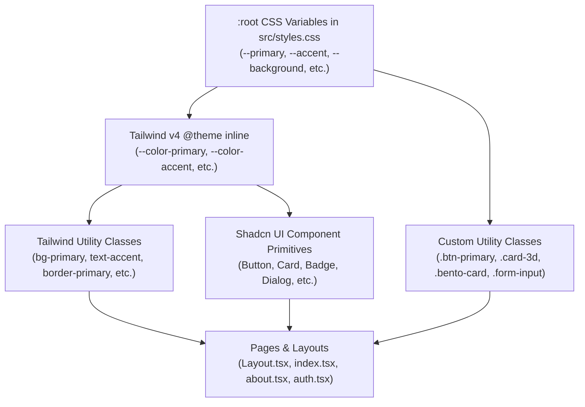

# UI Color & Style Architecture Report
**Project:** ZyphorZone Landing & Launch  
**Generated:** September 2026  
**Objective:** Comprehensive analysis of UI colors, styles, tokens, and guide for customizing the visual theme.

---

## 1. Executive Summary & Styling Hierarchy

The project runs on **Tailwind CSS v4** coupled with **Shadcn UI (Radix Primitives)** and **TanStack Start (React 19)**.

The color architecture is built as a hierarchical token cascade:



Because **90%+ of the styles originate from the `:root` variables in [src/styles.css](src/styles.css)**, modifying the base variables and matching hover glows allows you to re-theme the entire application consistently without touching dozens of individual component files.

---

## 2. Complete Color & Style Token Inventory

All global tokens are defined in `:root` inside [src/styles.css](src/styles.css#L34-L82):

| CSS Variable | Current Value | Tailwind Class | Semantic Purpose & Usage |
| :--- | :--- | :--- | :--- |
| `--background` | `#07080D` | `bg-background` | Base background color of the HTML body and main screen canvas |
| `--foreground` | `#F8FAFC` | `text-foreground` | Primary text, titles, headings, and high-emphasis icons |
| `--surface` | `rgba(15, 18, 28, 0.72)` | `bg-surface` | Glassmorphic card surface with backdrop blur |
| `--surface-elevated` | `rgba(22, 27, 42, 0.88)` | `bg-surface-elevated` | Hover state for cards, dropdown menus, and elevated panels |
| `--surface-hover` | `rgba(28, 35, 54, 0.95)` | N/A | High-contrast interactive hover states |
| `--card` | `#0C0E17` | `bg-card` | Fallback opaque card surface for shadcn primitives |
| `--card-foreground` | `#F8FAFC` | `text-card-foreground` | Text color rendered within shadcn cards |
| `--primary` | `#6366F1` *(Electric Indigo)* | `bg-primary`, `text-primary`, `border-primary` | Main brand color, primary CTA buttons, active states, key icons |
| `--primary-hover` | `#4F46E5` *(Deep Indigo)* | `hover:bg-primary-hover` | Hover background for primary action items |
| `--primary-foreground`| `#FFFFFF` | `text-primary-foreground` | Text rendered on top of primary-colored surfaces |
| `--secondary` | `#121624` | `bg-secondary` | Subdued secondary containers, pill tags |
| `--secondary-foreground`| `#E2E8F0` | `text-secondary-foreground`| Text rendered on top of secondary surfaces |
| `--muted` | `#111420` | `bg-muted` | Inactive tracks, secondary toggle backgrounds |
| `--muted-foreground` | `#94A3B8` *(Slate 400)* | `text-muted-foreground` | Secondary copy, subtitle text, form placeholders |
| `--accent` | `#06B6D4` *(Cyber Aqua/Cyan)*| `bg-accent`, `text-accent`, `border-accent` | Feature badges, metrics (+84%), checkmark icons, secondary glow |
| `--accent-foreground` | `#07080D` | `text-accent-foreground` | Text rendered on top of solid accent elements |
| `--destructive` | `#EF4444` *(Crimson Red)* | `bg-destructive`, `text-destructive` | Error notifications, sign-out button hover, delete modals |
| `--border` | `rgba(255, 255, 255, 0.08)` | `border-border` | Subtle hairline borders on glass cards and section dividers |
| `--border-subtle` | `rgba(255, 255, 255, 0.04)` | N/A | Ultra-faint separators |
| `--border-highlight` | `rgba(99, 102, 241, 0.35)` | N/A | Glowing border accents on focused/hovered items |
| `--input` | `rgba(255, 255, 255, 0.06)` | `border-input` | Border & background tint for form inputs |
| `--ring` | `rgba(99, 102, 241, 0.5)` | `ring-ring` | Keyboard focus ring color |

### Brand Gradients & Shadows

| CSS Variable | Current Definition | Used By |
| :--- | :--- | :--- |
| `--gradient-brand` | `linear-gradient(135deg, #818CF8 0%, #6366F1 50%, #06B6D4 100%)` | `.btn-primary`, `.gradient-text` |
| `--gradient-brand-subtle` | `linear-gradient(135deg, rgba(99, 102, 241, 0.15) 0%, rgba(6, 182, 212, 0.1) 100%)` | Decorative background gradients |
| `--gradient-hero` | `radial-gradient(120% 120% at 50% 0%, rgba(99, 102, 241, 0.18) 0%, rgba(7, 8, 13, 0.8) 60%, #07080D 100%), radial-gradient(...)` | Hero ambient lighting effect |
| `--gradient-card-border` | `linear-gradient(135deg, rgba(255, 255, 255, 0.14) 0%, rgba(255, 255, 255, 0.02) 40%, rgba(99, 102, 241, 0.25) 100%)` | Pseudo-element border mask for `.card-3d` |
| `--shadow-glow` | `0 0 50px -10px rgba(99, 102, 241, 0.4)` | Primary indigo glow filter |
| `--shadow-glow-cyan` | `0 0 50px -10px rgba(6, 182, 212, 0.35)` | Secondary cyan accent glow |
| `--shadow-soft` | `0 24px 60px -20px rgba(0, 0, 0, 0.85)` | Deep dark drop shadows |

---

## 3. Codebase File Map: Where Styles & Colors Live

### 1. [src/styles.css](src/styles.css) (Core Theme File)
This is the **heart of the styling system**:
- **Lines 7–32 (`@theme inline`)**: Maps the CSS variables to Tailwind v4 class names.
- **Lines 34–82 (`:root`)**: Declares all color hex codes, surface RGBA values, brand gradients, and shadow glows.
- **Lines 110–117 (`.gradient-text`)**: Gradient text utility using `--gradient-brand` and Indigo text-shadow.
- **Lines 127–142 (`.glass-card`)**: Blur backdrop card with Indigo hover shadow (`rgba(99, 102, 241, 0.25)`).
- **Lines 144–185 (`.card-3d`)**: Hover border color `rgba(99, 102, 241, 0.4)` and gradient border `rgba(99, 102, 241, 0.8)` to `rgba(6, 182, 212, 0.6)`.
- **Lines 187–224 (`.bento-card`)**: Bento box styling with Indigo & Cyan hover effects.
- **Lines 226–260 (`.btn-primary`)**: Primary button gradient, cyan & indigo drop shadows.
- **Lines 291–317 (`.form-input`)**: Input focus borders using `var(--primary)` and indigo outer glow.
- **Lines 336–355 (`.icon-3d`)**: Icon container with hover scale and indigo border/glow.
- **Lines 387–401 (`::-webkit-scrollbar`)**: Scrollbar track `#07080D` and thumb hover `rgba(99, 102, 241, 0.5)`.

### 2. [src/components/Layout.tsx](src/components/Layout.tsx) (Global Shell)
- **Line 77**: Global text selection styling: `selection:bg-primary selection:text-white`.
- **Lines 80–85**: Ambient background floating orbs:
  - `bg-primary/10 blur-[160px]`
  - `bg-accent/8 blur-[170px]`
  - `bg-primary/8 blur-[150px]`
  - `bg-accent/6 blur-[160px]`
- **Lines 93–94**: Navbar background colors:
  - Scrolled: `bg-[#07080D]/80 border-white/[0.08]`
  - Unscrolled: `bg-[#07080D]/40 border-white/[0.04]`
- **Line 211**: Footer background: `bg-[#0A0C14]/90 border-white/[0.08]`.

### 3. [src/routes/index.tsx](src/routes/index.tsx) (Landing Page)
- **Lines 437–441**: Hero badge: `border-primary/30 bg-primary/[0.08] text-primary`, ping orb `bg-accent`.
- **Line 516**: Hero card ambient blur: `from-primary/30 via-accent/20 to-primary/20`.
- **Line 533**: Headline text gradient: `from-white via-slate-100 to-slate-400`.
- **Lines 732–741**: **Tokens Spectrum preview card** with hardcoded sample color swatches:
  - Line 736: `bg-[#6366F1]` *(Primary Violet)*
  - Line 737: `bg-[#06B6D4]` *(Cyber Cyan)*
  - Line 738: `bg-[#10B981]` *(Success Mint)*
  - Line 739: `bg-[#0E111B]` *(Obsidian Base)*
- **Lines 1084 & 1087**: Portfolio cards overlay `bg-gradient-to-t from-[#07080D]` and badge `bg-[#07080D]/80`.
- **Lines 1392 & 1439**: Live interactive terminal mockup:
  - Top OS bar: `bg-[#0A0C15]/90 border-white/[0.08]`
  - Canvas background: `bg-gradient-to-b from-[#090C18]/60 to-[#07080D]/90`

### 4. Other Route Pages ([about.tsx](src/routes/about.tsx), [help.tsx](src/routes/help.tsx), [contact.tsx](src/routes/contact.tsx), [auth.tsx](src/routes/auth.tsx))
- All standard pages inherit the design system via `PageShell`, `.card-3d`, `.form-input`, `.btn-primary`, and `.btn-ghost`.
- `auth.tsx` (lines 109–122): Tab buttons toggle with `bg-primary text-white shadow-md`.

### 5. [src/components/ui/](src/components/ui/) (Shadcn UI Components)
All 46 Shadcn components ([button.tsx](src/components/ui/button.tsx), [card.tsx](src/components/ui/card.tsx), [badge.tsx](src/components/ui/badge.tsx), [dialog.tsx](src/components/ui/dialog.tsx), etc.) reference the CSS variable tokens (`bg-primary`, `bg-secondary`, `bg-card`, `border-input`, `ring-ring`).

---

## 4. Step-by-Step Blueprint to Change the UI Colors

### Step 1: Update `:root` in `src/styles.css` (80% of changes)
Open [src/styles.css](src/styles.css#L34-L82) and replace:
1. `--primary` and `--primary-hover` with your desired main color.
2. `--accent` with your secondary accent color.
3. `--gradient-brand` with your new gradient.
4. `--shadow-glow` and `--shadow-glow-cyan` with the matching RGB values.

### Step 2: Synchronize Custom Utilities in `src/styles.css` (15% of changes)
In [src/styles.css](src/styles.css):
1. **`.btn-primary` (lines 239–253)**: Replace the shadow RGBA values `rgba(99, 102, 241, ...)` and `rgba(6, 182, 212, ...)` with your primary and accent RGBA.
2. **`.card-3d` & `.bento-card` hover states (lines 173–184, 214–223)**: Replace the hover border and glow RGBA values.
3. **`.form-input:focus` (lines 310–311)**: Replace the focus shadow RGBA values.
4. **Scrollbar hover (line 399)**: Replace `rgba(99, 102, 241, 0.5)`.

### Step 3: Update Hardcoded Edge Cases (5% of changes)
1. **[src/components/Layout.tsx](src/components/Layout.tsx)**: If you change the dark pitch background (`#07080D`), update lines 93–94 and line 211.
2. **[src/routes/index.tsx](src/routes/index.tsx)**: Update the "Tokens Spectrum" swatch cards on lines 736–739 to display your new palette colors visually.

---

## 5. Ready-to-Paste Color Presets

### Preset A: Cyberpunk Emerald (Neon Matrix Green & Mint)
```css
/* In src/styles.css :root */
--primary: #10B981;
--primary-hover: #059669;
--primary-foreground: #022c22;

--accent: #06B6D4;
--accent-foreground: #082f49;

--gradient-brand: linear-gradient(135deg, #34D399 0%, #10B981 50%, #06B6D4 100%);
--gradient-brand-subtle: linear-gradient(135deg, rgba(16, 185, 129, 0.15) 0%, rgba(6, 182, 212, 0.1) 100%);
--shadow-glow: 0 0 50px -10px rgba(16, 185, 129, 0.4);
--shadow-glow-cyan: 0 0 50px -10px rgba(6, 182, 212, 0.35);
```

### Preset B: Solar Amber & Crimson Flame (High-Energy Warm)
```css
/* In src/styles.css :root */
--primary: #F97316;
--primary-hover: #EA580C;
--primary-foreground: #FFFFFF;

--accent: #FBBF24;
--accent-foreground: #451a03;

--gradient-brand: linear-gradient(135deg, #FB923C 0%, #F97316 50%, #F43F5E 100%);
--gradient-brand-subtle: linear-gradient(135deg, rgba(249, 115, 22, 0.15) 0%, rgba(251, 191, 36, 0.1) 100%);
--shadow-glow: 0 0 50px -10px rgba(249, 115, 22, 0.45);
--shadow-glow-cyan: 0 0 50px -10px rgba(251, 191, 36, 0.35);
```

### Preset C: Royal Sapphire (Modern Enterprise Blue)
```css
/* In src/styles.css :root */
--primary: #2563EB;
--primary-hover: #1D4ED8;
--primary-foreground: #FFFFFF;

--accent: #38BDF8;
--accent-foreground: #082f49;

--gradient-brand: linear-gradient(135deg, #60A5FA 0%, #2563EB 50%, #38BDF8 100%);
--gradient-brand-subtle: linear-gradient(135deg, rgba(37, 99, 235, 0.15) 0%, rgba(56, 189, 248, 0.1) 100%);
--shadow-glow: 0 0 50px -10px rgba(37, 99, 235, 0.4);
--shadow-glow-cyan: 0 0 50px -10px rgba(56, 189, 248, 0.35);
```

### Preset D: Neon Synthwave (Violet & Vivid Fuchsia)
```css
/* In src/styles.css :root */
--primary: #8B5CF6;
--primary-hover: #7C3AED;
--primary-foreground: #FFFFFF;

--accent: #EC4899;
--accent-foreground: #500724;

--gradient-brand: linear-gradient(135deg, #A78BFA 0%, #8B5CF6 50%, #EC4899 100%);
--gradient-brand-subtle: linear-gradient(135deg, rgba(139, 92, 246, 0.15) 0%, rgba(236, 72, 153, 0.1) 100%);
--shadow-glow: 0 0 50px -10px rgba(139, 92, 246, 0.45);
--shadow-glow-cyan: 0 0 50px -10px rgba(236, 72, 153, 0.35);
```

### Preset E: Titanium & Minimal Mono (Luxury Monochromatic)
```css
/* In src/styles.css :root */
--background: #090A0F;
--surface: rgba(22, 24, 33, 0.72);
--surface-elevated: rgba(30, 34, 48, 0.9);

--primary: #E2E8F0;
--primary-hover: #FFFFFF;
--primary-foreground: #090A0F;

--accent: #94A3B8;
--accent-foreground: #090A0F;

--gradient-brand: linear-gradient(135deg, #FFFFFF 0%, #CBD5E1 50%, #94A3B8 100%);
--gradient-brand-subtle: linear-gradient(135deg, rgba(255, 255, 255, 0.12) 0%, rgba(148, 163, 184, 0.08) 100%);
--shadow-glow: 0 0 50px -10px rgba(255, 255, 255, 0.25);
--shadow-glow-cyan: 0 0 50px -10px rgba(148, 163, 184, 0.2);
```

---

## 6. Summary Checklist for Applying Changes

- [ ] Choose your preferred primary and accent colors.
- [ ] Update `:root` in [src/styles.css](src/styles.css).
- [ ] Update matching hover glow RGBA values in `.btn-primary`, `.card-3d`, and `.bento-card` in [src/styles.css](src/styles.css).
- [ ] Update swatch boxes in [src/routes/index.tsx](src/routes/index.tsx) (lines 736–739).
- [ ] Verify pages in browser: Landing page, Navigation header, About page, Help center, and Auth modal.
